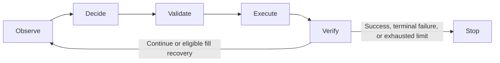

# Autonomous Browser Task Agent

A small LLM-driven browser agent for local BrowserGym/MiniWoB benchmarks. It
observes the accessibility tree, selects a structured action through the OpenAI
API, validates it, executes it, and checks the benchmark outcome. The current
milestone supports clicks, text filling, bounded multi-step execution, and
controlled recovery from an injected fill failure.

**Status, 22 October 2026:** 148 offline tests passed during update preparation;
two browser checks remain opt-in. Matched planning comparisons and a first
recovery-on/off ablation are complete on small exploratory samples.
User-run live evaluations passed the selected baseline tasks and six simulated
recovery episodes. These are small local benchmark results; natural browser
failure recovery and arbitrary websites have not been established. See the
[milestone report](docs/MILESTONE-REPORT.md) for evidence and limits.

## Run in the existing project

The commands below assume the existing repository, `.venv`, installed Chromium,
and `vendor/miniwob-plusplus` checkout. They are not a fresh-machine installer.

```bash
cd ~/Projects/autonomous-browser-agent
source .venv/bin/activate
python -m pytest tests -q
python -m browser_agent --task click-test --seed 42
```

The test suite should report 87 passing tests. The single run makes a live API
request and exits zero only when benchmark success is verified. The key is read
from `OPENAI_API_KEY` in the environment or the ignored `.env.local` file; an
existing environment variable takes precedence. Keep the real file private and
use `.env.example` only as a non-secret template. API access requires funded API
billing; a ChatGPT subscription is separate. Do not paste or log credentials.

## Supported tasks

| Task | Intended successful actions | Suggested budget |
|---|---|---:|
| `click-test` | Click the target button | 2, the default |
| `click-button` | Match the requested button label | 2 |
| `click-button-sequence` | Click ONE, then TWO | 2 |
| `enter-text` | Fill the requested text, then Submit | 2 |
| `login-user` | Fill two synthetic fields, then Login | 3 |

`click-button` generates a variable number of buttons. Every task uses the
existing local MiniWoB HTML, not a real account or external website. The model
chooses IDs and text from observations and the goal; they are not hardcoded.

```bash
python -m browser_agent --task enter-text --seed 42
python -m browser_agent --task login-user --seed 42 --max-steps 3
```

Success requires positive reward, a terminated episode, no truncation, and no
reported action error. An action executing without error is not task success.

## Baseline evaluation

```bash
python -m browser_agent.evaluate --tasks click-test click-button click-button-sequence enter-text --seeds 7 123
python -m browser_agent.evaluate --tasks login-user --seeds 7 42 123 --max-steps 3
```

These are separate suites with ceilings of 16 and nine API calls respectively.
Recovery is disabled. Without arguments, the baseline evaluator runs the three
click tasks at seeds 7 and 123: six episodes with a 12-call ceiling.

Each evaluation creates `results/eval-<UTC timestamp>-<unique id>/`, with one
sanitized episode record per completed attempt and `summary.json`. The summary
states planned, attempted, unattempted, completeness, success rates and reported
usage. Infrastructure errors stop the suite; benchmark failures count as failed
episodes and evaluation continues. Unknown usage is marked explicitly. Exit zero
requires every planned episode to pass. New baseline summaries identify their
mode as `baseline`; some earlier saved summaries predate this label.

## Controlled fill-recovery evaluation

```bash
python -m browser_agent.evaluate_recovery
python -m browser_agent.evaluate_recovery --task login-user --seeds 7 42 123 --max-steps 4
```

The first command evaluates `enter-text` at seeds 7, 42 and 123 with a three-step
budget, at most nine calls. The second allows four steps per login episode,
at most 12 calls. Each deliberately fails its first fill before touching the
page. Expected recovery is a fresh observation, a successful fill, then the
remaining task actions.

Results go into a separate `results/recovery-eval-.../` folder, labeled
`simulated_fill_recovery`. Reports confirm the injection and track recovered
episodes separately. The baseline parser rejects simulated reports. This
demonstrates recovery from a known injected error, not general failure tolerance.

For a single labeled demonstration:

```bash
python -m browser_agent --task enter-text --seed 42 --max-steps 3 --max-recoveries 1 --simulate-fill-error-once
```

## Workflow and controls



| Control | Current behavior |
|---|---|
| Actions | Strict Pydantic `click` or `fill`; no extra fields |
| Targets | Click observed button IDs; fill observed textbox IDs |
| Text | Nonempty, at most 256 characters for fill; null for click |
| Action/API budget | `--max-steps` from 1–6, default 2; failed attempts consume allowance |
| Recovery | `--max-recoveries` from 0–2, default 0; only eligible nonterminal fill errors |
| Evaluation limit | At most 12 episodes and 24 planned API calls |
| API request | 20-second timeout, zero SDK retries, at most 256 output tokens |
| Input | Goal ≤1,000 characters; tree ≤8,000; history ≤6 actions and ≤4,000 JSON characters |
| Run time | In-process deadline `max(90, 25 × max_steps + 15)` seconds |
| Evaluation deadline | Process-group deadline ten seconds beyond run deadline |

The model uses `gpt-4.1-mini-2025-04-14` through the Responses structured-output
adapter. Store is disabled on requests. Character/token/call limits bound work;
they are not a dollar-denominated billing cap. API failures can still be billable.

No model-produced Python is accepted. BrowserGym executes its action mapping
internally; the mapping emits fixed Playwright templates with quoted literal
IDs and text. Schema and observed-role validation happen before execution.
The injected failure is also a fixed trusted template. Click errors, invalid
actions, API errors and unexpected environment exceptions stop execution.

Successful-action history excludes failed actions. Progress retains every attempt
and distinguishes `execution_ok` from `benchmark_success`. After an eligible
failed fill, the next decision receives a fresh observation and bounded error
context, without raw browser diagnostics. Recovery cannot increase the budget.

## Files and reports

| File | Purpose |
|---|---|
| `browser_agent/actions.py` | Action schemas, role validation and literal action mapping |
| `browser_agent/model.py` | API adapter, usage tracking and bounded request context |
| `browser_agent/workflow.py` | Five LangGraph nodes, progress and recovery routing |
| `browser_agent/budget.py` | Budget validation and timeout calculation |
| `browser_agent/recovery.py` | Explicit one-fill failure simulator |
| `browser_agent/__main__.py` | Single-run CLI, local task setup and cleanup |
| `browser_agent/evaluate.py` | Baseline evaluation and shared suite support |
| `browser_agent/evaluate_recovery.py` | Labeled simulated recovery evaluation |
| `tests/` | Offline tests using fake models/environments; no API credit needed |
| `scripts/smoke_miniwob.py` | Original manual Day 1 click smoke test |

Single-run reports are named
`results/day2-<task>-seed<seed>-budget<N>-recovery<R>-sim<0-or-1>.json`.
Repeating the same configuration overwrites that single-run report. Its history
contains synthetic filled text, including the benchmark's generated password.
Evaluation records omit typed values and raw logs. `results/`, `.venv/` and real
environment files are ignored; curated non-secret evidence is retained under
`docs/evidence/`.

Verified direct package versions are recorded in `requirements-day2.txt` and
the milestone report. The historical filename is retained. It is not a complete
dependency lock or a fresh-machine reproducibility guarantee. Older milestone
READMEs remain as historical instructions; use this README for current commands.

## If a run stops

- HTTP 429 can mean exhausted API credits or a rate limit; check API billing and limits before retrying.
- HTTP 401 suggests credentials; 403/404 can indicate project or model access.
- A missing task HTML message means the expected local vendor checkout is absent.
- A budget failure is not a benchmark pass; increase the explicit allowance only when the task needs more actions.
- For a stopped evaluation, inspect `complete`, `unattempted` and unknown-usage counts before interpreting its success rate.

## Comparative findings — Phase 4

See the [experiment findings](docs/EXPERIMENT-FINDINGS.md) and curated evidence.
Both one-shot and iterative planning succeeded on six matched task instances
across text entry, ordered clicks and login. One-shot used fewer calls and was
faster on these instances. In two matched induced-timeout instances, recovery-off
succeeded on 0/2 and recovery-on on 2/2, using two additional model calls and
4.63 additional seconds per episode on average. These are exploratory controlled
results, not general success-rate claims or proof of superiority.

```bash
python -m browser_agent.run_oneshot --task enter-text --seed 11 --max-steps 2
python -m browser_agent.compare --tasks enter-text --seeds 11 29 --max-steps 2
python -m browser_agent.ablate_recovery --task enter-text --seeds 31 47 --max-steps 3 --scenario disabled_textbox_timeout
```

Commands make paid API calls. Comparison results go into unique `comparison-...`
and `recovery-ablation-...` directories under ignored `results/`. They check both
initial observations, and the recovery ablation also checks the first failure
signature, before accepting a matched pair. Benchmark failures remain in the data.
A completed experiment does not imply that every agent run succeeded.

Current single-run filenames also include a controlled scenario suffix. Historical
milestone and result files may predate it. Older milestone reports describe the
state at their dates; use the newer experiment findings for comparative results.

## Next work

Test naturally occurring fill failures and cases with partial effects, add
deterministic failure-path coverage before broader retries, then expand tasks
only with corresponding role validation and evaluation. General web browsing,
navigation, checkbox/select actions, screenshots/vision, real credentials and
unrestricted recovery are outside the current validated scope.
