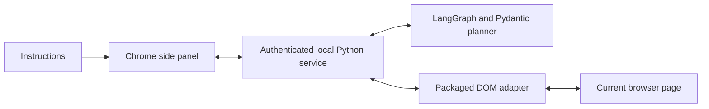

# Autonomous Browser Agent — Form Assistant

A Chrome side-panel assistant that fills supported fields on the current page from your
instructions. Watch the browser work, answer missing questions, and review before submitting.

**Stack:** Python, LangGraph, OpenAI structured outputs, Pydantic, JavaScript, Chrome Manifest V3.
**Current product:** extension version 0.2.0; local service required.

## Run

Use the existing project environment:

```bash
cd ~/Projects/autonomous-browser-agent
source .venv/bin/activate
python -m extension_service.server
```

Keep the terminal open. In Chrome, open `chrome://extensions`, enable Developer mode,
choose **Load unpacked**, and select the repository's `extension/` folder. Open your form,
click the extension icon, and connect using the code printed in the terminal. This code is
not the API key. After restarting the service, enter its new code in the panel's Settings.

For the first test, open `http://127.0.0.1:8766/practice` and supply synthetic details:

```text
Name: Alex Example
Email: alex@example.com
Organization: Example University
Session: Afternoon
Attend Day 1 and Day 2.
Dietary preference: Vegetarian.
```

Click **Fill form**. The practice page has two sections and disabled submission. Live
planning uses the existing ignored `.env.local` OpenAI key and API credits. Full installation,
privacy and compatibility details: [extension guide](docs/EXTENSION.md).

## Capabilities

- Detect text, search and paragraph inputs, native choices/dropdowns and simple editable
  text regions across the page, including outside forms and across multiple forms.
- Inspect open shadow roots and accessible same-origin frames; support Google Forms controls.
- Ask for missing required information and permission to replace a conflicting existing answer.
- Validate structured plans, execute fixed field operations, read values back and retry once
  when eligible. Supported Next transitions can advance sections; Stop halts further work.
- Leave submission and protected/unsupported questions for human review.

Universal form compatibility is not claimed. Cross-origin/sandboxed frames, closed shadow
roots, browser-protected pages, passwords, files, CAPTCHA and some custom controls are outside
scope. A website may autosave when fields change. Relevant form data and instructions are
sent to OpenAI; the API key stays in the Python service.

## Architecture



The shared workflow is **observe → decide → validate → execute → verify**. Model-generated
JavaScript is never executed. Product limits include 24 model calls, 60 counted interactions,
40 observed questions, eight sections and a ten-minute deadline. These are resource controls,
not hard monetary billing caps.

## Validation

- Finalization: 340 offline tests passed, including four cleanup checks; seven targeted local
  Chromium checks passed separately. Browser checks use simulated model responses and temporary profiles, with no
  paid API requests or real form submissions.
- Earlier frozen MiniWoB research: iterative **57/60 (95.0%)**, one-shot **55/60 (91.7%)**
  across 20 tasks and three reserved seeds per task.
- Controlled timeout recovery: **6/6 enabled versus 0/6 disabled** across matched induced faults.

The benchmark score belongs to the earlier MiniWoB agent, not real-website form filling.
The extension's live-model success rate on real websites has not been measured.
[Audited benchmark report](docs/FINAL-BENCHMARK-REPORT.md) · [project details](docs/PROJECT-DETAILS.md)

```bash
python -m pytest tests -q
RUN_BROWSER_TESTS=1 python -m pytest tests/test_browser_extension.py -q
python scripts/check_benchmark_plan.py
```

## Repository

| Path | Purpose |
| --- | --- |
| `extension/` | Current Chrome interface and DOM adapter |
| `extension_service/` | Local authenticated browser/model bridge |
| `form_assistant/` | Shared planner, validation, workflow and practice form |
| `browser_agent/` | Frozen MiniWoB research implementation |
| `app/`, `website_trial/` | Earlier demos; some shared dependencies remain in use |
| `tests/`, `scripts/` | Verification, audit and cleanup tools |
| `docs/benchmark/`, `docs/evidence/` | Frozen protocol and preserved experiment evidence |
| `docs/history/` | Archived milestone instructions |
| `vendor/`, `.venv/` | Local benchmark assets and Python environment; retain locally |

New environment installs use `python -m pip install -r requirements.txt`. Direct dependency
pins are provided; a clean-machine reproduction and transitive lock remain unverified.
MiniWoB reproduction also needs the matching vendor assets and Chromium installation.
Do not commit `.env.local`, `.venv/`, local `results/` or `vendor/`.

[CV and interview notes](docs/PORTFOLIO.md) · [release status](docs/RELEASE-CHECKLIST.md)
