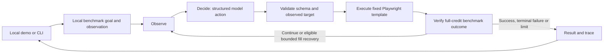

# Form Assistant — Chrome extension

Open a form in Chrome, click the assistant, provide your details and watch supported
fields fill in the current tab. Visible textboxes across the page are candidates, including
standalone/search inputs and editable text regions. The plain panel has one instruction
textbox, Fill form, Stop and status.
Submission stays with you.

Start the local connection with `python -m extension_service.server`, then load the
`extension/` folder through Chrome’s **Load unpacked** option.
See [installation and first run](docs/EXTENSION.md).

The earlier browser application and research benchmark are preserved below.

---

# Autonomous Browser Task Agent

An LLM-driven agent for local BrowserGym/MiniWoB tasks. It reads an accessibility
observation, selects a Pydantic action, validates the observed target, executes a fixed
Playwright action template, and checks benchmark completion through a LangGraph workflow.
The project investigates when fresh observations and bounded recovery justify additional
model calls compared with a fixed one-shot plan.

**Status:** the frozen Phase 4 evaluation and report are complete. The local demo and
portfolio documentation are implemented. User-run interface checks on 22 October 2026
confirmed text-entry success (two calls) and controlled-timeout recovery (three calls,
one recovery), both at development seed 61 with full credit and worker exit 0.
These checks are separate from the frozen final evaluation. See the
[demo verification record](docs/DEMO-VERIFICATION.md) for scope and remaining checks.

## Form Assistant — current product

Run `python -m app.demo` and open **http://127.0.0.1:8765**. Add a public Google Forms
link and your instructions/details, then click **Fill form**. A visible browser fills
supported text/choice questions and checks its entries. Missing required answers appear
as inline questions. Submit is never clicked; consent, payment declarations and unsupported
questions are left for manual review. Start with **Try a practice form** and synthetic data.

The new `form_assistant/` package is separate from the frozen benchmark and uses a bounded
LangGraph page-planning and per-field verification workflow. It has its own budgets and
compatibility limits. See [FORM-ASSISTANT.md](docs/FORM-ASSISTANT.md) for scope, privacy,
checks and the real-form acceptance procedure. Viewing the interface makes no API calls;
filling a form uses the existing local key, at most 24 model requests per task.

The previous Wikipedia product is still available with `python -m app.demo --wikipedia`.
Historical instructions below describe that separate extension; the default homepage is
now the form assistant. The benchmark demo remains at `--benchmark`.

## Measured results

Model: `gpt-4.1-mini-2025-04-14`. Twenty local task IDs × three held-out instance seeds,
with matched initial observations and equal per-task action budgets.

| Planning mode | Full-credit success | Reported calls | Mean duration |
|---|---:|---:|---:|
| One-shot fixed plan | 55/60 (91.7%) | 60 | 4.06 s |
| Iterative agent | 57/60 (95.0%) | 114 | 5.03 s |

In a separate controlled-timeout ablation, recovery off completed 0/6 and recovery on
6/6. This tests induced faults, not naturally occurring website failures. Across all
132 episodes: 201 reported calls, one episode with potentially incomplete usage.
No statistical superiority claim follows from this small, related-task suite.

Read the [final report](docs/FINAL-BENCHMARK-REPORT.md),
[frozen protocol](docs/benchmark/PROTOCOL.md), and
[evidence provenance](docs/evidence/final-v1/provenance.json).
On `click-collapsible-2`, iterative completed 3/3 and one-shot 0/3; on three checkbox/radio
instances, one-shot succeeded where iterative failed. The tradeoff depends on the task.

## Existing-machine setup

These instructions target the verified Mac/Python 3.11.9 environment. They are not a
fresh-machine dependency lock or cross-platform guarantee. Keep the existing local
`vendor/miniwob-plusplus` checkout; its source/asset hashes are in the freeze manifest.
Do not replace it with an arbitrary newer vendor checkout for reproducing v1 results.

```bash
cd ~/Projects/autonomous-browser-agent
source .venv/bin/activate
python -m pytest tests -q
python scripts/check_benchmark_plan.py
```

If rebuilding the environment outside the frozen run, use Python 3.11.9, create a `.venv`,
install `requirements-day2.txt` plus `playwright==1.44.0`, then install Chromium with
`python -m playwright install chromium`. The historical requirements filename is retained.
It pins direct packages, not every transitive dependency. The manifest records tested
versions; an environment upgrade creates a new reproducibility baseline.

Live runs read the existing `OPENAI_API_KEY` environment variable or ignored `.env.local`
(environment takes precedence). Use `.env.example` as a blank template; enter a key privately
in the local file, never a tracked source file, terminal command history or shared screenshot.
No key is needed to view the saved demo results or run offline tests. API billing is separate
from ChatGPT. Keep `.env.local`, `.venv`, local results and vendor files out of staging.

## Earlier Wikipedia application

```bash
python -m app.demo --wikipedia
```

Open **http://127.0.0.1:8765**. The main screen has an instruction box, Run, Stop and
run status. Benchmark tables are kept in the report rather than the application home page.
A fresh visible Chromium window opens when you run a supported task.

Examples of supported Wikipedia instructions:

- “Type quantum computing in the Wikipedia search box, without submitting.”
- “Search Wikipedia for the James Webb Space Telescope.”
- “Search Wikipedia for black holes and open the article.”

An LLM interprets your query and objective, then a LangGraph agent chooses actions from
fresh observations. Instructions are not matched to a fixed sentence catalogue. Supported
objectives are currently typing, searching and opening a search article on English Wikipedia;
this is not arbitrary website control. It cannot edit articles, log in, purchase or fill
unrelated forms. Unsupported instructions are reported as such.

Each task allows at most seven model calls, including one interpretation request, and six
browser actions, with a 200-second task deadline. Runs use your existing local API key.
The finished website remains open for up to five minutes, or until Stop/new task/server exit.
Live product runs are separate from final benchmark results. Do not operate the automation's
browser while a task is running. The new Wikipedia path requires a user-run live check;
o live product success is claimed from offline tests alone.

Run `python -m app.demo --benchmark` to access the earlier benchmark demonstration if needed.
For usage and verification limits see [PRODUCT.md](docs/PRODUCT.md). The measured results
remain in the [final report](docs/FINAL-BENCHMARK-REPORT.md).

## Agent commands

These commands make paid API requests on local development instances:

```bash
python -m browser_agent --task enter-text --seed 61 --max-steps 2
python -m browser_agent.run_oneshot --task enter-text --seed 61 --max-steps 2
```

All 20 enabled tasks and budgets are in [task-plan.json](docs/benchmark/task-plan.json).
The baseline evaluator is iterative with recovery off; `compare` runs both planning modes.
Do not rerun final seeds until failures turn into successes or relabel later development
as original final evidence. The full final schedule remains in `final-batches.json`.

To reproduce the offline evidence audit into a NEW directory:

```bash
python -B scripts/audit_final_v1.py --root . --output results/final-v1-audit-reproduction
```

It launches no browsers or models and refuses duplicate final batches and overwritten audit
outputs. Optional browser plumbing checks require the existing local Chromium installation:

```bash
RUN_BROWSER_TESTS=1 python -m pytest tests/test_browser_selection.py tests/test_browser_tabs.py tests/test_browser_benchmark_links.py -q
```

These tests do not call a model. The normal suite skips opt-in browser checks.

## Architecture and controls



- Strict actions: click, fill, set_checked, check_radio, select_option, activate_tab,
  and a narrowly scoped local benchmark-link action. No arbitrary model-generated code.
- Targets must match the current observed role/catalogue. Link enrichment exposes only
  visible, scoped benchmark spans. Both planning modes retain execution-time checks.
- Explicit 1–7 action limit, default two; at most one iterative request per permitted
  step. One-shot uses one request and a bounded plan. Failed attempts consume allowance.
- Recovery defaults off, permits only eligible nonterminal fill errors, and cannot expand
  the budget. Controlled fault demonstrations are labelled separately.
- Request timeout 20 s, no SDK retries; episode deadline `max(90, 25 × steps + 15)` s,
  with a ten-second subprocess grace. Evaluation batches cap at 24 planned requests.
- Full-credit success requires terminal reward 1 within tolerance, no truncation and no
  final action error. Execution without error or partial positive reward is not completion.
- Inputs, action history, outputs and run duration are bounded. These are resource controls,
  not dollar billing caps. Unknown usage is retained.

Frozen core: `browser_agent/`. Demo: `app/`. Audits: `scripts/`. Tests: `tests/`.
The demo adds a shell around the core; it does not modify frozen prompts or agent logic.

## Limitations and next work

This is local synthetic automation with related task variants, three final seeds per task,
no real services, and no evidence of general-web reliability. One-shot cannot replan after
new targets appear. Iterative can exhaust its budget or produce invalid actions. Recorded
exports omit action-level details, so some exact failure causes remain unknown. The browser
binary/OS were not hashed, and model responses and timing can vary.

Future work: structured redacted per-action evidence, loop detection tested on development
instances, naturally occurring failure cases, a new protocol for any broader-site evaluation,
and a clean-machine setup check. None of those changes are claimed in the frozen v1 result.
Historical README-* files describe earlier milestones; this README and the final report
are the current entry points. See [portfolio notes](docs/PORTFOLIO.md) for a measured project
summary and [release checklist](docs/RELEASE-CHECKLIST.md) for remaining packaging work.
